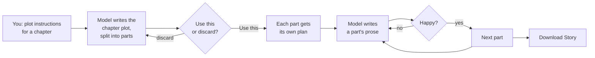

# Basic usage

How to go from an idea to a written chapter.

← [Back to the README](../README.md) · Not installed yet? [Installation](INSTALL.md)

---

## Watch it

> 🎬 **Video:** 
## How it works
[https://christian-marheim-ai-made.github.io/story_loom/demo_video/20261023_134454_Export.MOV](https://github.com/user-attachments/assets/3dfad188-c494-4249-8914-dca72314e1b2)

> ✏️ **Sketch:**

1. **You say what happens.** A few sentences of plot instructions for a
   chapter.
2. **The model plans.** It writes the chapter's plot, already divided
   into parts (5 by default), and you keep it or ask for another.
3. **The model writes.** One part at a time, each from its own plan and
   from everything written before it. You can ask for another version of
   any part, and you choose which one counts.
4. **You take it with you.** Download the finished story as a text or
   Markdown file.

---

## Step by step

Story Loom must be running and open in your browser
(<http://127.0.0.1:8888/index.html>) — see [Installation](INSTALL.md),
Steps 8 and 9.

### 1. Write the chapter's plot

1. The story is empty. Click **✍ Start from your instructions**.
   Chapter 1 is created and opened.
2. *(Optional)* Type a title under **Chapter Name**.
3. Under **Plot Instructions**, write in your own words what should happen
   in this chapter. A few sentences are enough.
4. **Parts** is how many parts the chapter is split into. It starts at 5;
   you can leave it.
5. Click **▶ Write the plot**.

The first time, the model has to load onto your graphics card — this takes
a minute or two before any text appears.

✔ Done when a plot appears with a **Use this** button.

6. Read it.
   - Happy? Click **Use this**. The chapter now has its 5 parts, each with
     its own plan.
   - Not happy? Click **discard**, change your instructions if you like,
     and click **▶ Write the plot** again.

### 2. Write the prose

1. In the list on the left, click the chapter's **first part**.
2. Click **▶ Write this part**.

✔ Done when the part's text appears.

3. Not happy with it? Click **▶ Write another version**. Every version is
   kept, and you choose which one counts.
4. Click the next part in the list and repeat, until all parts are written.

### 3. Save your story as a file

Click **Download Story** at the top, then choose **Text (.txt)** or
**Markdown (.md)**.

---

Want more control — secrets, feedback, rewriting single paragraphs,
studying a story? See [Advanced usage](ADVANCED.md).
